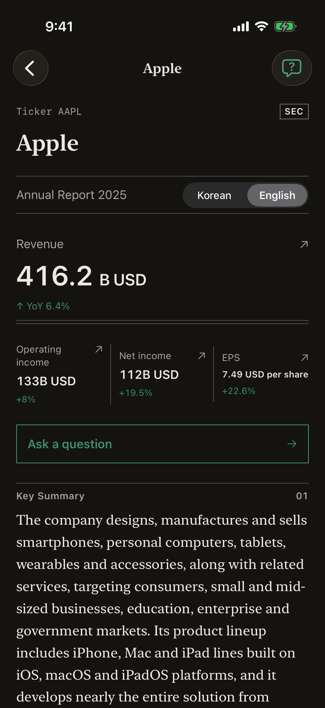

# Filing Digest

An iPhone app for exploring Korean and US company filings, with financial figures and links to the originals.

**[Recorded walkthrough](https://mhju0.github.io/filing-digest/)** · [한국어](https://mhju0.github.io/filing-digest/?lang=ko) · [English](https://mhju0.github.io/filing-digest/?lang=en) · [Filing Agent](https://github.com/mhju0/filing-agent)

The walkthrough is a read-only recording with no API calls. The SwiftUI app and FastAPI backend run locally; this is a portfolio project, not an App Store release.



## Engineering decisions

- Structured DART and SEC figures bypass the language model. Code checks reporting-period compatibility before calculating year-over-year changes.
- KURE-v1 and pgvector retrieve filing passages. Citation and financial-expression guards can withhold generated prose while keeping available figures visible; they do not establish sentence-level factual support.
- Filings become searchable only after indexing completes. Citations resolve through stored chunks to openable regulator sources.

SwiftUI · Python 3.11 · FastAPI · PostgreSQL + pgvector · KURE-v1 · Gemini Flash-Lite

## Run locally

Requires Python 3.11 and Docker Compose; the iOS client also needs Xcode 16+. Configure your own DART/Gemini keys and SEC contact details in the ignored environment file.

```bash
python3.11 -m venv .venv
.venv/bin/pip install -r backend/requirements.lock
cp backend/.env.example backend/.env
docker compose up -d db
cd backend && ../.venv/bin/python -m uvicorn app.main:app --reload --port 8001
```

A fresh database is empty. Follow the [development guide](docs/DEVELOPMENT.md) for ingestion, iOS setup and checks. The API has no authentication: keep it local.

## Scope

Annual filings only, with supported DART DSD prose and selected SEC 10-K Item 1/Item 7 sections. The [evaluation](backend/evals/README.md) covers a small project-authored question set for Apple, Microsoft and Samsung Electronics; it does not establish general financial accuracy.

**Status:** v0.5.2 maintenance. [Policy and limits](docs/MAINTENANCE.md) · [Architecture](docs/ARCHITECTURE.md) · [Coverage](docs/COVERAGE.md) · [Release history](https://github.com/mhju0/filing-digest/releases)

## License

Copyright (c) 2026 Michael Ju. All rights reserved.
No license is granted for use, copying, modification, or distribution of this code as of 2026-07-30. This repository is public for portfolio review purposes only.
